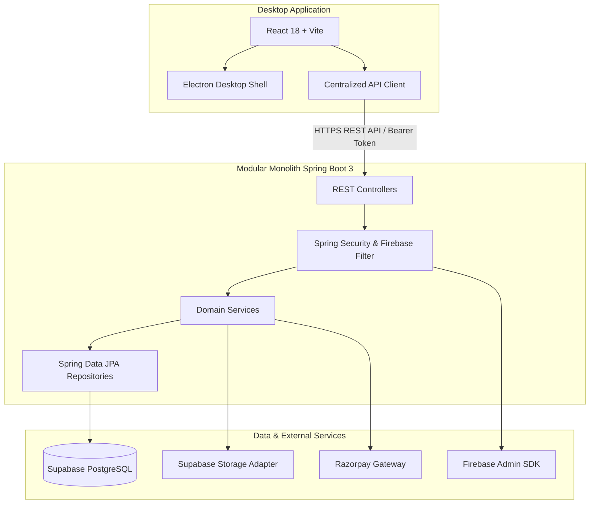

# QuickBite — Campus Food Marketplace & Ordering System

QuickBite is a desktop-based campus food marketplace connecting **Buyers** (students/faculty), **Shop Owners**, **Delivery Partners**, and **Campus Administrators**. Built with an Electron + React desktop frontend and a modular monolith Spring Boot backend backed by Supabase PostgreSQL, Firebase Authentication, and Razorpay test payments.

---

## 🏛 Architecture Overview



### Key Architectural Tenets
1. **Frontend-Backend Separation**: The frontend never connects directly to PostgreSQL, stores database credentials, or authoritative business logic. All pricing, inventory reservations, authorization, and state transitions are strictly executed and validated on the backend.
2. **Modular Monolith**: Organized into clean domain packages (`identity`, `buyer`, `shop`, `ordering`, `payment`, `delivery`, `administration`, `accountdeletion`, `feedback`, `dispute`, `audit`, `storage`, `security`, `common`, `config`).
3. **No Mutable Role Column**: Strict profile exclusivity is enforced. An `AccountIdentity` connects to exactly one profile table (`users`, `delivery_partners`, `shop_owners`, or `admins`).

---

## 📊 Complete Database Schema (16 Tables)

Managed via Flyway versioned migration (`V1__initial_schema.sql`):

| # | Table Name | Purpose | Key Constraints & Invariants |
|---|---|---|---|
| 1 | `account_identities` | Auth identity root | Unique `firebase_uid`, case-insensitive unique `email` |
| 2 | `users` | Buyer profiles | Unique `identity_id`, `account_status` (`ACTIVE`, `DEACTIVATED`, `SUSPENDED`) |
| 3 | `delivery_partners` | Delivery courier profiles | Unique `identity_id`, vehicle/phone details |
| 4 | `shop_owners` | Food shop vendor profiles | Unique `identity_id`, manages maximum one shop |
| 5 | `admins` | Campus administrators | Unique `identity_id`, provisioned via trusted pipeline only |
| 6 | `shops` | Campus food establishments | `approval_status` (`PENDING`, `APPROVED`, `REJECTED`, `SUSPENDED`), `is_open`, `is_deactivated` |
| 7 | `products` | Menu items | `price >= 0`, `stock_quantity >= 0`, `is_available` |
| 8 | `orders` | Customer food orders | `total_amount = subtotal + delivery_fee - discount_amount`, state transition graph |
| 9 | `order_items` | Immutable item snapshots | Preserves `product_name_snapshot`, `unit_price_snapshot`, `quantity > 0` |
| 10 | `payments` | Transaction records | `provider` (`RAZORPAY`), `idempotency_key`, `status` (`CAPTURED`, etc.) |
| 11 | `refunds` | Refund requests & tracking | Capped at captured payment amount; idempotency enforced |
| 12 | `delivery_assignments`| Courier delivery tasks | 1-to-1 with order; assigned partner access control |
| 13 | `account_deletion_requests` | Vendor/courier deactivations | Admin review workflow; self-review strictly prohibited |
| 14 | `feedback` | Buyer ratings & reviews | 1 per delivered order; rating 1–5 stars |
| 15 | `disputes` | Order disputes & resolution | Raised by buyer/admin; admin resolution audit trail |
| 16 | `audit_logs` | Append-only security audit | Actor identity, target type, structured JSON metadata |

---

## 🔒 Security & Authorization Highlights

- **Mutually Exclusive Identities**: Profiles are enforced atomically. Creating a profile locks the identity row and verifies no other profile exists.
- **Resource-Level Authorization**: Shop owners can only edit their own shop/products. Delivery partners can only see and update their assigned orders. Buyers can only see their own orders and raise disputes on their own orders.
- **Server-Side Pricing**: The cart price sent by the client is never trusted. The backend recalculates item line totals, subtotal, delivery fees (free over ₹200), and validates stock.
- **Payment Verification**: Razorpay payment signatures are validated using HMAC-SHA256 (`order_id + "|" + payment_id` against key secret).
- **Electron Hardening**: `nodeIntegration: false`, `contextIsolation: true`, secure preload bridge (`window.quickbiteDesktop`), strict CSP headers.

---

## 🛠 Technology Stack

- **Desktop Shell**: Electron 30
- **Frontend**: React 18, Vite, React Router 6, Lucide React, Vanilla CSS3 (Custom design system)
- **Backend**: Java 17 / 21, Spring Boot 3.3.5, Spring Security 6, Spring Data JPA / Hibernate, Flyway
- **Database**: Supabase PostgreSQL (dev/offline fallback via H2 PostgreSQL mode)
- **External Services**: Firebase Admin SDK (Auth tokens), Razorpay Java SDK (Test payments), Supabase Storage

---

## 🚀 Getting Started Locally

### Prerequisites
- **Java**: JDK 17 or higher (`java -version`)
- **Maven**: 3.8+ (included or installed)
- **Node.js**: v18+ and npm (`node -v`)

### 1. Clone & Configure Environment Variables
Copy `.env.example` to `.env` in the root and fill in required test keys:
```bash
cp .env.example .env
```

### 2. Run the Backend
```bash
cd backend
mvn clean test             # Run the full automated test suite
mvn spring-boot:run        # Start the Spring Boot API server on port 8080
```
API Documentation (Swagger UI): `http://localhost:8080/swagger-ui.html`
OpenAPI Specs: `http://localhost:8080/v3/api-docs`

### 3. Run the Desktop Frontend (Vite Dev Server)
In a separate terminal:
```bash
cd frontend
npm install
npm run dev
```
Access the web view at `http://localhost:5173`.

### 4. Run Desktop Electron Shell
```bash
cd frontend
npm run electron:dev
```

---

## 🧪 Automated Test Suite

Run backend automated tests with:
```bash
cd backend
mvn test
```
The test suite covers:
- **`AuthServiceTest`**: Identity creation, buyer profile provisioning, and prevention of duplicate profiles.
- **`PricingServiceTest`**: Exact calculations of subtotal, free delivery fee threshold (over ₹200 vs under ₹200), and invariant check (`total = subtotal + fee - discount`).
- **`OrderStateTransitionTest`**: Order lifecycle validations (`PLACED` -> `ACCEPTED` -> `PREPARING` -> `READY` -> `OUT_FOR_DELIVERY` -> `DELIVERED`), cancellation eligibility, and rejection of invalid backwards transitions.
- **`DeliveryStateTransitionTest`**: Courier lifecycle (`ASSIGNED` -> `ACCEPTED` -> `PICKED_UP` -> `DELIVERED`).
- **`FeedbackEligibilityTest`**: Enforces feedback submission only on `DELIVERED` orders, buyer ownership check, and rating bounds (1–5).
- **`RefundCapAndStateTest`**: Verifies that refund requests cannot exceed the captured payment amount and checks idempotency.

---

## 📦 Building for Production

### Build the Backend JAR
```bash
cd backend
mvn clean package -DskipTests
```
The executable fat JAR is generated at `backend/target/quickbite-backend-1.0.0.jar`.
Run it anywhere with:
```bash
java -jar backend/target/quickbite-backend-1.0.0.jar
```

### Build the Frontend Static Assets
```bash
cd frontend
npm run build
```
Optimized distribution files are placed into `frontend/dist/`.

### Package Desktop Application (Windows Installer / Executable)
```bash
cd frontend
npm run dist
```
Uses `electron-builder` to package the React bundle and Electron main process into Windows installer/portable executables in `frontend/release/`.

---

## 👥 Demo Accounts (Development Profile)
When running with the default development seed enabled (`quickbite.seed-demo-data: true`):
- **Buyer**: `buyer@campus.edu` (John Doe)
- **Shop Owner**: `owner@campus.edu` (Green Bowl Salads)
- **Delivery Partner**: `courier@campus.edu` (Alex Swift)
- **Admin**: `admin@campus.edu` (Campus Admin)

You can toggle between all 4 accounts seamlessly using the in-app role switch button on the navigation bar!
