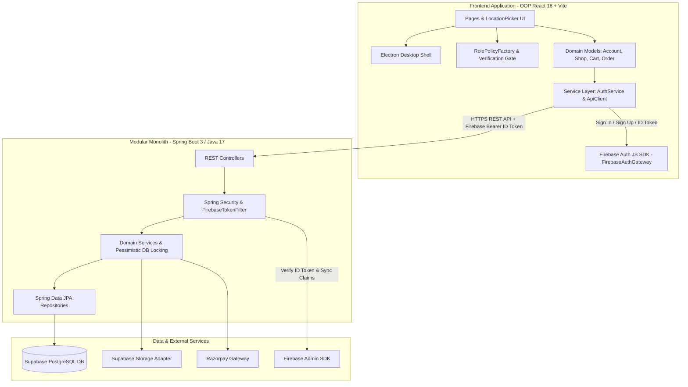

# QuickBite — Anywhere Food Marketplace & Delivery Platform

QuickBite is a full-stack food marketplace and delivery platform connecting **Buyers**, **Shop Owners**, **Delivery Partners**, and **Platform Administrators** across **any location** — open to anyone ordering from, operating, or delivering in any neighborhood or city. Built with an Electron + React desktop/web frontend structured with OOP domain models/policies/services and a modular-monolith Spring Boot 3 backend connected directly to **Supabase PostgreSQL** with **Firebase Authentication** (Firebase Client SDK + Firebase Admin SDK token verification & custom claims), Razorpay test payments, and Supabase Storage.

---

## 🏛 Architecture Overview



### Environment Parity (Dev = Production)
- **No silent fallbacks**: `application.yml` and `application-dev.yml` require `SPRING_DATASOURCE_URL`, `SPRING_DATASOURCE_USERNAME`, `SPRING_DATASOURCE_PASSWORD` (pointing to Supabase PostgreSQL), `FIREBASE_AUTH_ENABLED=true` with `firebase-adminsdk.json`, and real Supabase Storage (`SUPABASE_URL`, `SUPABASE_SERVICE_ROLE_KEY`, `SUPABASE_STORAGE_BUCKET`).
- **Protected Storage Uploads**: `POST /api/v1/storage/upload` requires an authenticated `SHOP_OWNER` or `ADMIN` Firebase ID token and fails with exact Supabase errors (no Base64 `data:` fallback). Payments intentionally remain in Razorpay test/mock mode for local checkout testing.
- **Optional Proxy via `.env` only**: Proxy settings (`https.proxyHost`, `https.proxyPort`, `http.proxyHost`, `http.proxyPort`, `java.net.preferIPv4Stack`) live strictly in `backend/.env` (unconfigured in production and direct networks), automatically loaded by `QuickBiteApplication.loadDotEnv()`.
- If Supabase, Supabase Storage, Firebase, or a configured proxy is unreachable or misconfigured, startup or requests fail immediately with the exact underlying error message (`GlobalExceptionHandler`, `FirebaseConfig`, `FirebaseTokenFilter`, `SupabaseStorageAdapter`).

### OOP Class Hierarchies

#### Backend Java Entity Hierarchy
- `BaseAuditableEntity` (`@MappedSuperclass`: `createdAt`, `updatedAt`, lifecycle hooks)
  - `BaseAccountProfile` (abstract `@MappedSuperclass`: `identity`, `status`, `activate()`, `suspend()`, `deactivate()`, `isActive()`)
    - `Admin` (`verificationStatus`, `requestNote`)
    - `ContactableAccountProfile` (abstract `@MappedSuperclass`: `displayName`, `phone`, `updateProfileInfo()`)
      - `User` (Buyer with `defaultAddress`, `defaultLatitude`, `defaultLongitude`, `foodInterests`, `updateDeliveryLocation()`, `updateFoodInterests()`)
      - `ShopOwner` (Vendor owning at most one `Shop`)
      - `DeliveryPartner` (Courier with `verificationStatus`, `vehicleDetails`, `serviceArea`, `approveVerification()`, `rejectVerification()`, `isVerifiedAndActive()`, `canOperateOnPlatform()`)

#### Frontend JavaScript OOP Hierarchy
- **Models (`frontend/src/models/`)**:
  - `BaseModel`
    - `Account` -> `AdminAccount`
    - `Account` -> `ContactableAccount` -> `BuyerAccount`, `ShopOwnerAccount`, `DeliveryPartnerAccount` (`AccountFactory`)
    - `Shop` (supports `location`, `latitude`, `longitude`, `hasCoordinates()`, `getMapUrl()`, `matchesSearch()`, `getMatchingProducts()`)
    - `Product`, `Cart` (aggregate root enforcing single-shop cart & ₹300 free-delivery threshold), `CartItem`, `Order`
- **Polymorphic Policies (`frontend/src/policies/RolePolicy.js`)**:
  - `BaseRolePolicy` -> `BuyerPolicy`, `ShopOwnerPolicy`, `DeliveryPartnerPolicy`, `AdminPolicy` (`RolePolicyFactory`)
  - Enforces `getDefaultRoute(account)` and `canAccessRoute(pathname, account)` so unverified shop owners, delivery partners, and admins are confined strictly to verification/onboarding pages (`VerificationGate`).
- **Services & Gateways (`frontend/src/services/` & `frontend/src/config/`)**:
  - `FirebaseAuthGateway` (`frontend/src/config/firebase.js`): encapsulates Firebase JS SDK client auth (`signUp`, `signIn`, `refreshToken`, `rollbackUser`, `signOut`, ID token auto-refresh)
  - `BaseService` -> `AuthService`, `MarketplaceService`, `ShopOwnerService`, `OrderService`, `DeliveryService`, `AdminService`
- **Exceptions (`frontend/src/errors/AppErrors.js`)**:
  - `AppError` -> `HttpError`, `ValidationError`, `AuthenticationError`, `AuthorizationError`, `BusinessRuleViolationError`

---

## 🔒 Firebase Authentication & Verification Lifecycle

- **Firebase-First Login (`/login`)**:
  1. Email + password only (with Show/Hide toggle; no security key or verification selector on login).
  2. `FirebaseAuthGateway.signIn(email, password)` authenticates directly against Firebase Authentication and obtains a signed Firebase ID Token.
  3. Frontend sends `POST /api/v1/auth/login` with `Authorization: Bearer <Firebase_ID_Token>`.
  4. `FirebaseTokenFilter` verifies the token via `FirebaseAuth.getInstance().verifyIdToken(token)` (never accepting dev-token bypasses), resolves the matching profile from Supabase PostgreSQL, syncs Firebase custom claims, audits login, and routes the user according to their role & verification status.
- **Firebase-First Signup (`/signup`)**:
  1. `FirebaseAuthGateway.signUp(email, password, displayName)` creates the Firebase Auth account and gets a Firebase ID Token (passwords are stored in Firebase and never transmitted to the backend REST API).
  2. Frontend sends `POST /api/v1/auth/signup` with `Authorization: Bearer <Firebase_ID_Token>` and role/profile details to persist the user in Supabase PostgreSQL. If the backend rejects (e.g., invalid `ADMIN_SIGNUP_KEY`, conflict, or DB error), the frontend immediately rolls back (`deleteUser`) the Firebase user and displays the exact error.
  3. Backend `FirebaseAccountSyncService` syncs custom claims on Firebase users:
     - `BUYER`: `role="BUYER"`, `accountStatus` (always unblocked; no pending/verified/rejected status).
     - `SHOP_OWNER`, `DELIVERY_PARTNER`, `ADMIN`: `role`, `accountStatus`, `verificationStatus`, `status` (`pending`, `verified`, `rejected`, `suspended`, `removed`), and `verified` (`true`/`false`), updated in Firebase whenever Admin approves, rejects, suspends, removes, or verifies by key.
- **Strict Onboarding & Verification Gate**:
  - Signing up as `SHOP_OWNER`, `DELIVERY_PARTNER`, or `ADMIN` (without `ADMIN_SIGNUP_KEY`) lands on `/shop/onboarding`, `/delivery/verification`, or `/admin/verification` until approved by an active Admin.
  - Only verified existing accounts open directly into their full role dashboard on login.
- **Admin Key & Suspension Controls**:
  - **Buyers** cannot be blocked or suspended by Admins.
  - **Shop Owners** and **Delivery Partners** can be suspended or removed (`DEACTIVATED`, disabling their Firebase user and setting status `removed`).
  - **Admins** can sign up with `ADMIN_SIGNUP_KEY` (immediately verified) or by Admin Verification (`PENDING` until approved by an active Admin); suspending or reactivating another Admin requires `ADMIN_SIGNUP_KEY`.
- **Concurrent Delivery Acceptance DB Lock**:
  - `DeliveryService.claimAssignment` runs under `@Transactional(isolation = Isolation.READ_COMMITTED)` using pessimistic write locking, `@Version` optimistic locking, and conditional JPQL update returning `409 Conflict` to competing couriers.
- **Buyer-verified Delivery Completion**:
  - Each new order gets a six-digit OTP; the buyer sees it when the order is out for delivery, and the assigned courier must enter it to mark the order delivered.
  - The OTP is cleared after successful handover; delivery-partner and shop-owner order responses do not include it.
- **Personalized & Cold-Start Buyer Discovery**:
  - Default Buyer page (`/`) ranks items via `RecommendationService`, and `/shops` loads approved shops upfront with search filters by shop name, product/item, or location.

---

## 📊 Database Schema & Migrations

Managed via Flyway migrations (`V1__initial_schema.sql` through `V6__buyer_delivery_otp.sql`) in Supabase PostgreSQL across 16 tables (`account_identities`, `users`, `delivery_partners`, `shop_owners`, `admins`, `shops`, `products`, `orders`, `order_items`, `payments`, `refunds`, `delivery_assignments`, `account_deletion_requests`, `feedback`, `disputes`, `audit_logs`).

---

## 🛠 Technology Stack

- **Desktop Shell**: Electron 30
- **Frontend**: React 18, Vite, React Router 6, Firebase JS SDK (`firebase`), Lucide React, Vanilla CSS3
- **Backend**: Java 17+, Spring Boot 3.3.5, Spring Security 6, Spring Data JPA / Hibernate, Flyway, Firebase Admin SDK (`9.3.0`)
- **Database**: Supabase PostgreSQL (strictly required in `dev` and production)
- **External Services**: Firebase Authentication, Razorpay Java SDK (Test mode), Supabase Storage

---

## 👥 Seeded Test Accounts

All accounts are pre-seeded in Firebase Authentication and Supabase PostgreSQL with password **`QuickBite@123`**:

| Role | Email | Password | Profile / Details |
| :--- | :--- | :--- | :--- |
| **Admin** | `admin@quickbite.com` | `QuickBite@123` | Platform Operations Admin (Approvals, Disputes, Audit Logs) |
| **Buyer** | `buyer@quickbite.com` | `QuickBite@123` | Aarav Sharma (Indiranagar, Bengaluru) |
| **Shop Owner 1** | `shop@quickbite.com` | `QuickBite@123` | Chef Vikram Das — **Urban Spice Kitchen** (Indiranagar, 4 products) |
| **Shop Owner 2** | `shop2@quickbite.com` | `QuickBite@123` | Meera Nair — **Brew & Bite Cafe** (Koramangala, 4 products) |
| **Delivery Partner 1** | `delivery@quickbite.com` | `QuickBite@123` | Rohan Patel — Scooter (`KA-01-EQ-4492`) • Active |
| **Delivery Partner 2** | `delivery2@quickbite.com` | `QuickBite@123` | Kabir Verma — Electric Bicycle (`KA-03-EB-1088`) • Active |

---

## 🚀 Getting Started Locally

### 1. Environment Variables Configuration
Ensure configuration is set in:
- `backend/.env` (`SPRING_DATASOURCE_URL`, `SPRING_DATASOURCE_USERNAME`, `SPRING_DATASOURCE_PASSWORD`, `FIREBASE_PROJECT_ID`, `FIREBASE_AUTH_ENABLED=true`, `ADMIN_SIGNUP_KEY`, Razorpay & Supabase Storage keys)
- `backend/firebase-adminsdk.json` (Firebase Admin service account credentials)
- `frontend/.env` (`VITE_API_BASE_URL` pointing to local `http://localhost:8080/api/v1` or cloud `https://quickbite-backend-8qgw.onrender.com/api/v1`, plus Firebase client keys)

### 2. Run Backend API Server (Spring Boot)
```bash
cd backend
mvn spring-boot:run
```
- API Base: `http://localhost:8080/api/v1`
- Swagger UI Documentation: `http://localhost:8080/swagger-ui.html`
- Health Endpoint: `http://localhost:8080/api/v1/health`

### 3. Run Frontend Web / Desktop App
```bash
cd frontend

# Clean installation for cloned repositories:
npm ci
# Or standard install:
npm install

# Run web browser client (http://localhost:5173):
npm run dev

# Or run desktop Electron shell with hot-reload:
npm run electron:dev

# Build standalone Windows .exe installer/package:
npm run dist
```

---

## 🌐 Production Cloud Deployment
- **Backend API**: Hosted on Render at `https://quickbite-backend-8qgw.onrender.com/api/v1`
- **Health Check**: `https://quickbite-backend-8qgw.onrender.com/api/v1/health`
- **Database**: Supabase Managed PostgreSQL
- **Object Storage**: Supabase Storage (`QuickBite` bucket for storefront & food item photography)
- **Identity & Authentication**: Firebase Authentication (Client SDK + Firebase Admin SDK with custom claims)

