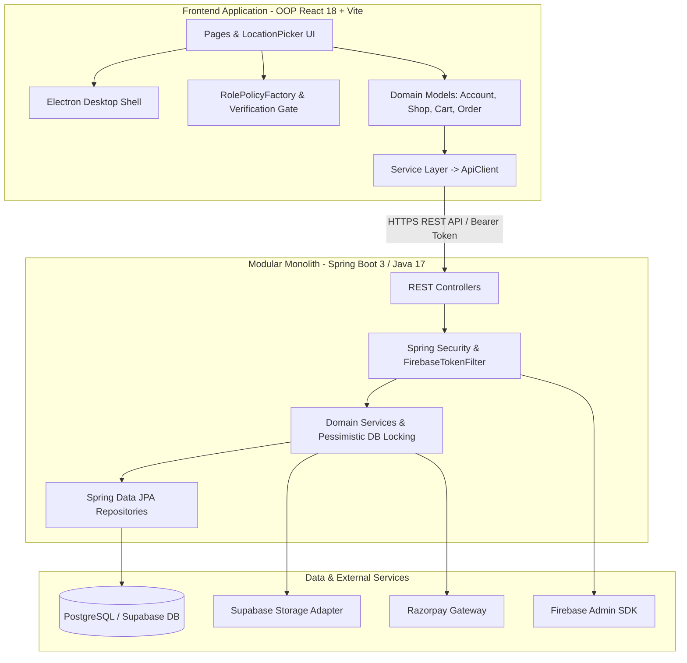

# QuickBite — Anywhere Food Marketplace & Delivery Platform

QuickBite is a full-stack food marketplace and delivery platform connecting **Buyers**, **Shop Owners**, **Delivery Partners**, and **Platform Administrators** across **any location** — open to anyone ordering from, operating, or delivering in any neighborhood or city. Built with an Electron + React desktop/web frontend structured with OOP domain models/policies/services and a modular-monolith Spring Boot 3 backend backed by PostgreSQL (Supabase / H2 PostgreSQL mode in dev/test), BCrypt password authentication + Firebase token support, Razorpay test payments, and Supabase Storage.

---

## 🏛 Architecture Overview



### OOP Class Hierarchies

#### Backend Java Entity Hierarchy
- `BaseAuditableEntity` (`@MappedSuperclass`: `createdAt`, `updatedAt`, lifecycle hooks)
  - `BaseAccountProfile` (abstract `@MappedSuperclass`: `identity`, `status`, `activate()`, `suspend()`, `deactivate()`, `isActive()`)
    - `Admin`
    - `ContactableAccountProfile` (abstract `@MappedSuperclass`: `displayName`, `phone`, `updateProfileInfo()`)
      - `User` (Buyer with `defaultAddress`, `defaultLatitude`, `defaultLongitude`, `foodInterests`, `updateDeliveryLocation()`, `updateFoodInterests()`)
      - `ShopOwner` (Vendor owning at most one `Shop`)
      - `DeliveryPartner` (Courier with `verificationStatus`, `vehicleDetails`, `serviceArea`, `approveVerification()`, `rejectVerification()`, `isVerifiedAndActive()`, `canOperateOnPlatform()`)

#### Frontend JavaScript OOP Hierarchy
- **Models (`frontend/src/models/`)**:
  - `BaseModel`
    - `Account` -> `AdminAccount`
    - `Account` -> `ContactableAccount` -> `BuyerAccount`, `ShopOwnerAccount`, `DeliveryPartnerAccount` (`AccountFactory`)
    - `Shop` (supports `location`, `latitude`, `longitude`, `hasCoordinates()`, `getMapUrl()`, `matchesSearch()`, `getMatchingProducts()`)
    - `Product`, `Cart` (aggregate root enforcing single-shop cart & ₹300 free-delivery threshold), `CartItem`, `Order`
- **Polymorphic Policies (`frontend/src/policies/RolePolicy.js`)**:
  - `BaseRolePolicy` -> `BuyerPolicy`, `ShopOwnerPolicy`, `DeliveryPartnerPolicy`, `AdminPolicy` (`RolePolicyFactory`)
  - Enforces `getDefaultRoute(account)` and `canAccessRoute(pathname, account)` so unverified shop owners & delivery partners are confined strictly to verification pages.
- **Services (`frontend/src/services/`)**:
  - `BaseService` -> `AuthService`, `MarketplaceService`, `ShopOwnerService`, `OrderService`, `DeliveryService`, `AdminService`

---

## 📊 Database Schema & Migrations (16 Tables)

Managed via Flyway migrations (`V1__initial_schema.sql`, `V2__general_locations_verification_and_locking.sql`, and `V3__buyer_food_interests.sql`):

| # | Table Name | Purpose | Key Constraints & Enhancements |
|---|---|---|---|
| 1 | `account_identities` | Auth identity root | Unique `firebase_uid`, case-insensitive unique `email`, `password_hash` |
| 2 | `users` | Buyer profiles | Unique `identity_id`, `account_status`, `default_address`, `default_latitude`, `default_longitude`, `food_interests` |
| 3 | `delivery_partners` | Courier profiles | Unique `identity_id`, `verification_status` (`PENDING`, `APPROVED`, `REJECTED`, `SUSPENDED`), `vehicle_details`, `service_area` |
| 4 | `shop_owners` | Vendor profiles | Unique `identity_id`, manages maximum one shop |
| 5 | `admins` | Platform administrators | Unique `identity_id`, provisioned securely |
| 6 | `shops` | Food establishments | `campus_location` (general address/place), `latitude`, `longitude`, `approval_status`, `is_open`, `is_deactivated` |
| 7 | `products` | Menu items | `price >= 0`, `stock_quantity >= 0`, `is_available`, indexed for product search |
| 8 | `orders` | Customer food orders | `total_amount = subtotal + delivery_fee - discount_amount`, `delivery_address`, `delivery_latitude`, `delivery_longitude` |
| 9 | `order_items` | Immutable item snapshots | Preserves `product_name_snapshot`, `unit_price_snapshot`, `quantity > 0` |
| 10 | `payments` | Transaction records | `provider` (`RAZORPAY`), `idempotency_key`, `status` |
| 11 | `refunds` | Refund tracking | Capped at captured payment amount; idempotency enforced |
| 12 | `delivery_assignments` | Courier delivery tasks | 1-to-1 with order, `@Version` optimistic lock column + `idx_delivery_assignments_status_partner` |
| 13 | `account_deletion_requests` | Removal confirmations | Admin review workflow; deactivates both `ShopOwner` & their `Shop` (and `DeliveryPartner`) |
| 14 | `feedback` | Buyer ratings & reviews | 1 per delivered order; rating 1–5 stars |
| 15 | `disputes` | Order disputes | Raised by buyer; admin resolution audit trail |
| 16 | `audit_logs` | Append-only security audit | Login/logout, approvals, claims, removals, structured metadata |

---

## 🔒 Security, Verification Gate & Delivery Locking Highlights

- **Proper Login & Logout**: Real email + password authentication (`BCryptPasswordEncoder` via `/api/v1/auth/login` and `/api/v1/auth/signup`), session verification (`/api/v1/auth/me`), and audited logout (`/api/v1/auth/logout`), alongside Firebase Admin token support (`FirebaseTokenFilter`).
- **Strict Onboarding & Verification Gate**:
  - Signing up as a `SHOP_OWNER` navigates exclusively to `/shop/onboarding` (`VerificationGate`) until an Admin approves their shop.
  - Signing up as a `DELIVERY_PARTNER` navigates exclusively to `/delivery/verification` (`VerificationGate`) until an Admin verifies their profile.
  - Backend endpoints (`MarketplaceController`, `OrderService`, `DeliveryController`) also reject requests from unverified or deactivated accounts with `403 Forbidden`.
- **Admin Confirmation for Platform Removal**: Shop Owners and Delivery Partners must submit an `AccountDeletionRequest` (`/api/v1/account/deletion-request`); platform presence is only removed once Admin confirms (`POST /api/v1/admin/deletion-requests/{id}/review`), which also deactivates the owner's `Shop`.
- **Concurrent Delivery Acceptance DB Lock**:
  - `DeliveryService.claimAssignment` runs under `@Transactional(isolation = Isolation.READ_COMMITTED)` using:
    1. `LockModeType.PESSIMISTIC_WRITE` (`SELECT ... FOR UPDATE`),
    2. Optimistic `@Version` on `DeliveryAssignment`, and
    3. Atomic conditional JPQL update (`WHERE status = 'UNASSIGNED' AND deliveryPartner IS NULL`) + DB verification re-read, returning `409 Conflict` to any competing delivery partner.
- **Personalized & Cold-Start Buyer Discovery + Dedicated Shops Directory**:
  - **Default Buyer Page (`/` — "For You • Top Items")**: `RecommendationService` (`GET /api/v1/marketplace/products/recommended`) ranks menu items using a hybrid score combining Bayesian rating priors, global popularity, shop open/location proximity, buyer `foodInterests` tags, and past purchase history. Fresh buyers with no prior orders or profile interests automatically receive diverse cold-start top-rated picks interleaved across shops.
  - **Browse All Shops (`/shops`)**: Loads all approved shops upfront before any search filter is applied, while allowing filtering by **shop name**, **product/food item name**, or **any location** (`/api/v1/marketplace/shops?q=&location=` and `/api/v1/marketplace/products/search?q=&location=`).
- **Server-Side Pricing & Payment Verification**: Backend `PricingService` calculates totals cleanly (orders below ₹300 incur ₹30 delivery fee; orders ₹300+ qualify for free delivery) and verifies Razorpay HMAC-SHA256 payment signatures.

---

## 🛠 Technology Stack

- **Desktop Shell**: Electron 30
- **Frontend**: React 18, Vite, React Router 6, Lucide React, Vanilla CSS3
- **Backend**: Java 17+, Spring Boot 3.3.5, Spring Security 6, Spring Data JPA / Hibernate, Flyway
- **Database**: PostgreSQL (Supabase; local H2 PostgreSQL-mode supported offline via default `dev` profile)
- **External Services**: Firebase Admin SDK, Razorpay Java SDK (Test mode), Supabase Storage

---

## 🚀 Getting Started Locally

### 1. Environment Variables
Keep or copy `.env.example` -> `.env` in root, `backend/`, and `frontend/` as configured for local/cloud keys.

### 2. Run Backend Tests & API Server
```bash
cd backend
mvn test                   # Run the full automated test suite (22 tests incl. recommendations & DB locking)
mvn spring-boot:run        # Start API on port 8080 (defaults to dev profile; set H2 datasource URL env override if remote DB port is blocked)
```
Swagger UI: `http://localhost:8080/swagger-ui.html`

### 3. Run Frontend Web / Electron App
```bash
cd frontend
npm install
npm run dev                # Starts Vite dev server on http://localhost:5173
# or:
npm run electron:dev       # Launches Electron desktop shell
```

---

## 🧪 Automated Test Suite

Run `mvn test` inside `backend/` to execute all 9 test classes:
- **`RecommendationServiceTest`**: Personalized interest/order scoring, fresh-user cold-start diversity, and upfront all-shop loading + search filters.
- **`DeliveryConcurrencyTest`**: Multi-threaded race simulation verifying only 1 delivery partner can claim an assignment under DB locking, verification-gate enforcement, and admin-confirmed shop+owner removal.
- **`AuthServiceTest`**: Identity creation, profile provisioning, and mutual-exclusivity checks.
- **`PricingServiceTest`**: Subtotal calculations, ₹300 free-delivery threshold, and total invariants.
- **`OrderStateTransitionTest`**: Order lifecycle transitions and cancellation eligibility.
- **`DeliveryStateTransitionTest`**: Assignment pickup and delivery lifecycle checks.
- **`FeedbackEligibilityTest`**: Rating bounds and delivered-order ownership checks.
- **`RefundCapAndStateTest`**: Refund cap enforcement and idempotency.
- **`StorageServiceTest`**: Storage adapter upload/validation behavior.

---

## 👥 Starter Accounts & Admin Security Key

When the database is empty on first startup, `DataSeeder` creates **1 starter account per role** (password **`QuickBite@123`**):
- **Admin**: `admin@quickbite.com` (Platform Operations Admin)
- **Buyer**: `buyer@quickbite.com` (Aarav Sharma — Indiranagar, Bengaluru)
- **Shop Owner**: `shop@quickbite.com` (Chef Vikram Das — *Urban Spice Kitchen*)
- **Delivery Partner**: `delivery@quickbite.com` (Rohan Patel — Verified & Active)

### Admin Onboarding & Key Protection
- **Instant Admin Signup**: Provide `ADMIN_SIGNUP_KEY` during signup to activate an Admin account immediately.
- **Request Admin Permission**: New signups (leaving the key blank) or existing Buyers (from **Profile → Request Admin Permission**) can ask active Admins for permission, which an active Admin can approve or decline under **Admin Team & Keys**.
- **Suspending an Admin**: Suspending or reactivating an Admin requires entering `ADMIN_SIGNUP_KEY`.
